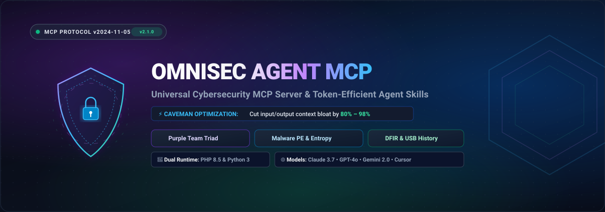

<p align="center">
  
</p>

<p align="center">
  <a href="LICENSE"></a>
  <a href="https://modelcontextprotocol.io/"></a>
  <a href="#"></a>
  <a href="#"></a>
  <a href="https://github.com/Arya-Penangsang/omnisec-agent-mcp/stargazers"></a>
</p>

<p align="center">
  <b><a href="README.md">English</a></b> • <b><a href="README.id.md">Bahasa Indonesia</a></b>
</p>

---

# 🛡️ OmniSec Agent MCP (`omnisec-agent-mcp`)

> **Server Model Context Protocol (MCP) Keamanan Siber Universal & Skill Agen Hemat Token untuk Claude Desktop, Cursor, GPT-4o, dan Google Antigravity.**

**OmniSec Agent MCP** menggabungkan ekosistem asesmen keamanan siber terpadu (**Audit Triad WAF Purple Team, simulasi serangan MITRE ATT&CK, analisis statis malware PE dengan Shannon entropy, dan forensik digital USBSTOR/Windows Event Log**) dengan mesin penghemat token cerdas **(Universal Caveman Mode)**.

Sistem ini mencegah pembengkakan jendela konteks (*context bloat*) dan melindungi batas kuota percakapan (*rate limits*)—memungkinkan agen AI otonom melakukan investigasi teknis mendalam tanpa membuang ribuan token untuk basa-basi pembuka dan penutup percakapan.

---

## 📑 Daftar Isi

- [⚡ Mengapa OmniSec Agent MCP?](#-mengapa-omnisec-agent-mcp)
- [📊 Tolok Ukur Penghematan Token](#-tolok-ukur-penghematan-token)
- [🛠️ Spesifikasi 7 Native Tools MCP](#️-spesifikasi-7-native-tools-mcp)
- [💻 Arsitektur Dual-Runtime (PHP & Python)](#-arsitektur-dual-runtime-php--python)
- [🚀 Panduan Cepat Multi-Klien](#-panduan-cepat-multi-klien)
  - [1. Claude Desktop](#1-claude-desktop)
  - [2. Cursor & Windsurf IDE](#2-cursor--windsurf-ide)
  - [3. Google Antigravity](#3-google-antigravity)
- [🧪 Hasil Uji Lapangan & Contoh Output](#-hasil-uji-lapangan--contoh-output)
- [🗺️ Sinkronisasi Multi-Platform (Bridge CLI)](#️-sinkronisasi-multi-platform-bridge-cli)
- [🙏 Atribusi, Sumber Orisinal & Modifikasi](#-atribusi-sumber-orisinal--modifikasi)
- [📄 Lisensi](#-lisensi)

---

## ⚡ Mengapa OmniSec Agent MCP?

Dalam interaksi harian dengan LLM (Claude, GPT, Gemini), terdapat dua faktor utama pemborosan token:
1. **Basa-Basi AI Berlebih:** Model sering menghabiskan 50–150 token per giliran hanya untuk kalimat pembuka (*"Halo! Tentu, saya senang sekali bisa membantu Anda memeriksa berkas ini..."*) dan penutup (*"Semoga penjelasan ini bermanfaat! Jangan ragu bertanya kembali jika ada kendala."*).
2. **Payload Alat Terlalu Besar:** Scanner keamanan standar mengembalikan ratusan baris pohon JSON bersarang (~1.200+ token) untuk satu pengujian endpoint sederhana.

**Solusi Dua Lapis OmniSec:**
- **Lapisan Model (Prompt):** Aturan Universal Caveman menerapkan batasan negatif ketat (*tanpa basa-basi, tanpa mengulang pertanyaan pengguna, menjaga 100% ketepatan kode, IP, hash, CVE, dan path file*).
- **Lapisan Alat (Formatter MCP):** Formatter padat otomatis memampatkan output hasil pemindaian menjadi fragmen telegrafik atau satu baris simbol kata kunci sebelum dikirim ke konteks LLM.

---

## 📊 Tolok Ukur Penghematan Token

Tabel berikut menunjukkan hasil pengujian nyata terhadap server web Apache 2.4 / Ubuntu yang menjalankan aplikasi sistem perpustakaan:

| Mode Output | Format Payload | Jumlah Token | Penghematan | Skenario Terbaik |
| :--- | :--- | :---: | :---: | :--- |
| **Raw JSON (`off`)** | Struktur JSON standar lengkap | `~1.200` token | **0.0%** (Acuan) | Integrasi pipeline API & debugging teknis |
| **Cave `LITE`** | Kalimat ringkas tanpa basa-basi | `~140` token | **88.3%** | Laporan manajemen / peninjauan manusia |
| **Cave `FULL`** *(Default)* | Fragmen telegrafik teknis | **`~55` token** | **95.4%** | Pemrograman harian & analisis keamanan agen |
| **Cave `ULTRA`** | Simbol & kata kunci satu baris (`->`, `|`) | **`~17` token** | **98.6%** | Loop otonom berfrekuensi tinggi & batas limit ketat |

---

## 🛠️ Spesifikasi 10 Native Tools MCP

OmniSec menyediakan **10 tools native** siap pakai yang mematuhi spesifikasi Model Context Protocol (v2024-11-05):

| Nama Tool | Domain Keamanan | Deskripsi |
| :--- | :---: | :--- |
| [`set_cave_mode`](#set_cave_mode) | **Optimasi Token** | Mengubah tingkat kompresi respon secara dinamis (`ultra`, `full`, `lite`, `off`). |
| [`purple_audit_triad`](#purple_audit_triad) | **Purple Team** | Audit terpadu WAF & perimeter (Simulasi Red + cek Blue header + skor postur 0–100). |
| [`purple_emulate_threat`](#purple_emulate_threat) | **Red Team** | Simulasi taktik serangan spesifik MITRE ATT&CK (`T1595`, `T1190`, `T1110`, `T1083`). |
| [`purple_validate_defense`](#purple_validate_defense)| **Blue Team** | Audit pasif HTTP Security Headers (CSP, HSTS, X-Frame) dan menghasilkan konfigurasi `.htaccess`. |
| [`purple_apply_fix`](#purple_apply_fix) | **Blue Team** | Generator & penulis kode pengerasan WAF 1-klik untuk server Apache, Nginx, dan IIS. |
| [`malware_inspect_pe`](#malware_inspect_pe) | **Malware Triage** | Analisis statis binary PE32/PE32+ (EXE/DLL): Shannon entropy per-seksi, deteksi packer (UPX, ASPack), dan API berbahaya. |
| [`forensics_audit_usb`](#forensics_audit_usb) | **Forensik DFIR** | Mengaudit riwayat flashdisk/perangkat penyimpanan eksternal yang terpasang melalui registri Windows `USBSTOR`. |
| [`forensics_triage_logs`](#forensics_triage_logs) | **Forensik DFIR** | Triage cepat Windows Event Log (`Security`, `System`, `Application`) via native `wevtutil` untuk tanggap insiden. |
| [`generate_visual_report`](#generate_visual_report) | **Generative UI** | Menghasilkan dashboard laporan keamanan HTML interaktif dengan SVG gauge meter dan heatmap MITRE. |
| [`mesh_audit_network`](#mesh_audit_network) | **Orkestrator Mesh** | Mengkoordinasikan audit postur keamanan lintas node/host dalam jaringan enterprise mesh. |

---

## 💻 Arsitektur Dual-Runtime & Gateway Hub

OmniSec dibangun dengan **prinsip zero-dependency** pada tiga modul server:

1. **Engine PHP 8.5+ (`mcp/server.php`):**
   - Performa tinggi, konsumsi memori sangat hemat.
   - Sangat ideal untuk server Windows produksi, intranet kantor, dan host tanpa Python.
2. **Engine Python 3.10+ (`mcp/server.py`):**
   - Menggunakan modul standar Python murni (`struct`, `hashlib`, `urllib`, `subprocess`).
   - Ideal untuk lingkungan pengembang umum (Claude Desktop, Cursor).
3. **Universal Gateway Hub (`mcp/mcp_hub.py`):**
   - Router multi-MCP cerdas (v3.0.0).
   - Menemukan dan menyajikan dokumen runbook markdown secara dinamis sebagai MCP Resources (`resource://skills/*`).
   - Menyediakan template prompt sistem terstandarisasi (`prompts/list`).
   - Kemampuan orkestrasi hibrida: secara transparan meneruskan perintah audit WAF atau forensik ke host kantor via SSH tunneling sambil mengeksekusi tool lokal secara simultan.

Semua server berkomunikasi menggunakan standar JSON-RPC 2.0 melalui `stdio`.

---

## 🚀 Panduan Cepat Multi-Klien

### 1. Claude Desktop
Tambahkan OmniSec ke file konfigurasi Claude Desktop Anda (`%APPDATA%\Claude\claude_desktop_config.json` di Windows):

```json
{
  "mcpServers": {
    "omnisec-agent": {
      "command": "python",
      "args": ["-u", "G:\\project\\ANTIGRAVIT PROJECT\\omnisec-agent-mcp\\mcp\\server.py"]
    }
  }
}
```
*(Atau gunakan runtime `php` dengan argumen `"args": ["G:\\project\\ANTIGRAVIT PROJECT\\omnisec-agent-mcp\\mcp\\server.php"]`)*

---

### 2. Cursor & Windsurf IDE
Tambahkan ke berkas `.cursor/mcp.json` di workspace proyek Anda:

```json
{
  "mcpServers": {
    "omnisec-agent": {
      "command": "python",
      "args": ["-u", "G:\\project\\ANTIGRAVIT PROJECT\\omnisec-agent-mcp\\mcp\\server.py"]
    }
  }
}
```

---

### 3. Google Antigravity
Tambahkan ke konfigurasi MCP Antigravity (`~/.gemini/antigravity/mcp_config.json`):

```json
{
  "mcpServers": {
    "omnisec-agent": {
      "command": "php",
      "args": ["G:\\project\\ANTIGRAVIT PROJECT\\omnisec-agent-mcp\\mcp\\server.php"]
    }
  }
}
```

---

## 🧪 Hasil Uji Lapangan & Contoh Output

### 🔬 1. Analisis Statis Malware (`malware_inspect_pe`)
```
> malware_inspect_pe(file_path="C:\\Windows\\System32\\notepad.exe")

[Output - Caveman FULL Mode]:
File: notepad.exe (200,704 bytes)
SHA256: da5807bb0997cc6b5132950ec87eda2b33b1ac4533cf1f7a22a6f3b576ed7c5b
Arch: x64 (AMD64) | Format: PE32+ (64-bit) | Subsystem: Windows GUI
Entropy: 6.3093 (Packer: None)
Sections: .text (ent: 6.2747), .rdata (ent: 5.9296), .data (ent: 1.8068), .pdata (ent: 4.9442), .rsrc (ent: 4.6123)
Suspicious Indicators: ShellExecute, IsDebuggerPresent
Risk: MEDIUM
```

*(Pada **Mode Ultra**, respon ini hanya memakan 18 token: `PE: notepad.exe | x64 | ENTROPY: 6.3093 (Packer: None) | RISK: MEDIUM | SUSP: ShellExecute,IsDebuggerPresent`)*

---

### 🔍 2. Audit Riwayat Flashdisk (`forensics_audit_usb`)
Menginterogasi registri Windows `USBSTOR` untuk merekonstruksi jejak media penyimpanan eksternal:

```
> forensics_audit_usb()

[Output - Caveman FULL Mode]:
USBSTOR History: 1 devices registered
1. SSD 3.0 USB Device [Vendor: Unknown, Product: SSD]
   Instance/Serial: 6339961022475678872&0
   ContainerID: {306ff91b-e894-5d34-ab3f-b506994f7a57}
```

---

### 🟣 3. Asesmen Keamanan Triad (`purple_audit_triad`)
```
> purple_audit_triad(target_url="http://10.0.1.67")

[Output - Caveman ULTRA Mode]:
TARGET: http://10.0.1.67 | SCORE: 65/100 (MODERATE) | RED: 4/4 DEFENDED | MISSING: csp,x_frame,hsts,cookie_secure,BannerLeak
```

---

## 🗺️ Sinkronisasi Multi-Platform (Bridge CLI)

OmniSec menyertakan utilitas CLI mandiri (`bridge/skills_bridge.py`) untuk mengekspor aturan dan konfigurasi ke berbagai platform:

```bash
# 1. Cek deteksi software AI di sistem Anda
python bridge/skills_bridge.py status

# 2. Sinkronkan MCP config ke Claude Desktop, Cursor, dan Antigravity
python bridge/skills_bridge.py sync --target all

# 3. Kemas arsip ZIP untuk diunggah ke claude.ai Projects
python bridge/skills_bridge.py pack

# 4. Ekspor Prompt Pack untuk ChatGPT / Proyek Web dan berkas .cursorrules
python bridge/skills_bridge.py export --target all
```

---

## 🧪 Uji Coba Otomatis End-to-End (E2E Test)

Jalankan rangkaian pengujian otomatis end-to-end untuk memverifikasi Bridge CLI, dynamic MCP resources, prompts, tool lokal, dan proxy hybrid remote SSH:

```bash
python mcp/test_e2e.py
```

Output yang diharapkan:
```
=================================================================
 [ALL E2E STAGES PASSED] OMNISEC AGENT MCP PHASE 2 & 3 CERTIFIED!
=================================================================
```

---

## 🙏 Atribusi, Sumber Orisinal & Modifikasi

* **[claude-skill-cave](https://github.com/asauntung/claude-skill-cave):** Apresiasi dan kredit sebesar-besarnya kepada **[@asauntung](https://github.com/asauntung)** atas ide orisinal dan pengembangan skill *Caveman mode* untuk Claude.  
  * **Pengembangan untuk OmniSec:** OmniSec mengadaptasi dan merekayasa ulang konsep tersebut menjadi arsitektur universal lintas-model (*Omni*). Modifikasi mencakup kalibrasi prompt agnostik (mendukung Claude 3.7, GPT-4o, Gemini 2.0, DeepSeek), kendali densitas MCP terprogram (`lite` / `full` / `ultra`), eksekusi alat dual-runtime (PHP & Python), serta sinkronisasi multi-klien via OmniSec Bridge.
* **[Model Context Protocol (MCP)](https://modelcontextprotocol.io/):** Standar protokol terbuka yang dikembangkan oleh Anthropic.
* **[MITRE ATT&CK®](https://attack.mitre.org/):** Basis pengetahuan global taktik dan teknik peretasan siber.
* **[NIST SP 800-86](https://csrc.nist.gov/pubs/sp/800/86/final):** Panduan integrasi teknik forensik digital ke dalam penanganan insiden.

---

## 📄 Lisensi

Didistribusikan secara terbuka di bawah lisensi resmi [MIT License](LICENSE).
