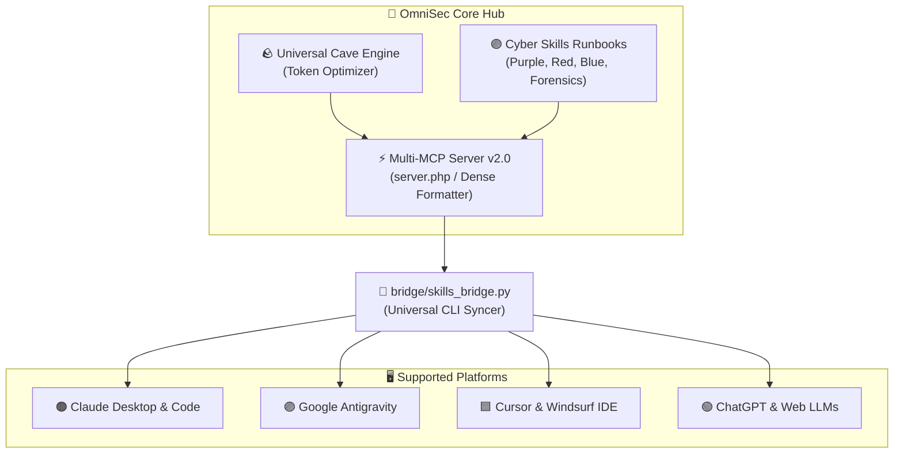

# 🛡️ OmniSec Agent MCP (`omnisec-agent-mcp`)

[](LICENSE)
[](https://modelcontextprotocol.io/)
[](#)

> **Universal Cybersecurity Model Context Protocol (MCP) Server & Token-Efficient Agent Skills for Claude, GPT, Antigravity, and Cursor.**

OmniSec bridges cybersecurity assessment tools (Purple Team WAF auditing, threat emulation, malware PE analysis, and DFIR forensics) with an aggressive **Token-Saving Engine (Universal Caveman Mode)**, ensuring your AI agents perform deep security triage without burning through conversation rate limits.

---

## ⚡ Key Highlights

1. **Dual Token-Saving Architecture:**
   * **Backend/Tool Level:** Multi-MCP dense output formatter cuts input tokens by **80%–98%**.
   * **Model/Prose Level:** Universal Caveman mode cuts output tokens by **60%–75%** by cutting filler words and pleasantries.
2. **Model-Agnostic:** Runs seamlessly on **Claude 3.5/3.7**, **GPT-4o/o1**, **Gemini 2.0/Pro**, and local models (**Ollama / DeepSeek**).
3. **Multi-Platform Bridge:** One-click sync to Claude Desktop, Claude Code, Antigravity, and Cursor.
4. **Local & Remote Office Execution:** Audit web targets locally or tunnel through remote hosts via SSH.

---

## 🗺️ Architecture Overview



---

## 📊 Token Conservation Benchmark

Actual benchmark from live audit against an Apache/Ubuntu web server:

| Output Mode | Payload Format | Token Count | Reduction | Best For |
| :--- | :--- | :---: | :---: | :--- |
| **Raw JSON (Disabled)** | Complete JSON tree | ~1,200 tokens | 0% | Machine debugging / API pipelines |
| **Cave `FULL` (Default)** | Structured telegraphic summary | **~55 tokens** | **95.4%** | Fast agent analysis & daily coding |
| **Cave `ULTRA`** | Single-line keyword/symbol string | **~17 tokens** | **98.6%** | High-frequency loops & rate limit saving |

---

## 🛠️ MCP Tools Overview

| Tool Name | Domain | Description |
| :--- | :---: | :--- |
| `set_cave_mode` | **Optimization** | Switch reply and tool density level (`lite`, `full`, `ultra`, `off`). |
| `purple_audit_triad` | **Purple Team** | Comprehensive triad audit: Red probes + Blue checks + overall posture scoring (0–100). |
| `purple_emulate_threat` | **Red Team** | Emulates specific MITRE ATT&CK techniques (`T1595`, `T1190`, `T1110`, `T1083`) against target. |
| `purple_validate_defense`| **Blue Team** | Evaluates HTTP Security Headers (CSP, HSTS, X-Frame) and produces instant `.htaccess` fix. |
| `malware_inspect_pe` | **Malware Triage** | Static PE32/PE32+ analysis, Shannon entropy, packer detection (UPX, ASPack), and suspicious APIs. |
| `forensics_audit_usb` | **Forensics** | Digital forensics triage for connected USB storage devices via Windows `USBSTOR` registry. |
| `forensics_triage_logs` | **Forensics** | Rapid DFIR triage of Windows Event Logs (`Security`, `System`, `Application`) via `wevtutil`. |

---

## 🚀 Quickstart

### 1. Check Platform Status
```bash
python bridge/skills_bridge.py status
```

### 2. Auto-Sync to Installed AI Clients
```bash
# Sync to Claude Desktop, Antigravity, and Cursor in one command:
python bridge/skills_bridge.py sync --target all
```

### 3. Pack ZIPs for Claude Web (claude.ai)
```bash
python bridge/skills_bridge.py pack
# ZIP files will be generated in dist_packages/ ready to upload.
```

---

## 🙏 Attribution, Source & Modification Notice

* **[claude-skill-cave](https://github.com/asauntung/claude-skill-cave)**: Special thanks and full credit to **[@asauntung](https://github.com/asauntung)** for creating the original Caveman mode skill for Claude.  
  * **Modification for OmniSec:** OmniSec adapts and expands this concept into a universal, multi-model ("Omni") token-saving engine. Modifications include model-agnostic prompt refactoring (supporting GPT-4o, Gemini, DeepSeek), universal negative constraints against model sycophancy, programmatic MCP density switches (`lite`/`full`/`ultra`), and multi-platform packaging via the OmniSec Bridge.
* **[Model Context Protocol (MCP)](https://modelcontextprotocol.io/)**: Open standard initiated by Anthropic.
* **MITRE ATT&CK for Enterprise**: Threat emulation taxonomy and technique definitions.

---

## 📄 License

Distributed under the [MIT License](LICENSE).
