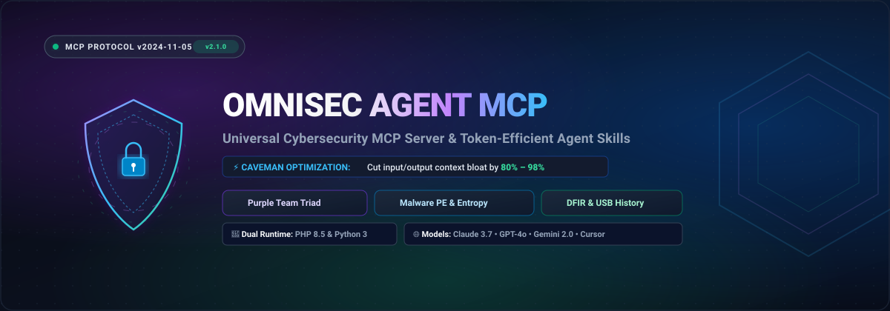

<p align="center">
  
</p>

<p align="center">
  <a href="LICENSE"></a>
  <a href="https://modelcontextprotocol.io/"></a>
  <a href="#"></a>
  <a href="#"></a>
  <a href="https://github.com/Arya-Penangsang/omnisec-agent-mcp/stargazers"></a>
</p>

<p align="center">
  <b><a href="README.md">English</a></b> • <b><a href="README.id.md">Bahasa Indonesia</a></b>
</p>

---

# 🛡️ OmniSec Agent MCP (`omnisec-agent-mcp`)

> **Universal Cybersecurity Model Context Protocol (MCP) Server & Token-Saving Agent Skills for Claude Desktop, Cursor, GPT-4o, and Google Antigravity.**

**OmniSec Agent MCP** bridges comprehensive cybersecurity assessment capabilities (**Purple Teaming WAF audits, MITRE ATT&CK threat emulation, static PE malware triage with Shannon entropy, and DFIR USBSTOR/Event Log forensics**) with a hyper-efficient **Token-Saving Engine (Universal Caveman Mode)**. 

It stops LLM context windows from overflowing and protects your rate limits—allowing autonomous coding and security agents to perform multi-step triage without burning thousands of tokens on unnecessary conversational filler.

---

## 📑 Table of Contents

- [⚡ Why OmniSec Agent MCP?](#-why-omnisec-agent-mcp)
- [📊 Token Conservation Benchmark](#-token-conservation-benchmark)
- [🛠️ Native MCP Tools Specification](#️-native-mcp-tools-specification)
- [💻 Dual-Runtime Architecture](#-dual-runtime-architecture)
- [🚀 Multi-Client Quickstart](#-multi-client-quickstart)
  - [1. Claude Desktop](#1-claude-desktop)
  - [2. Cursor & Windsurf IDE](#2-cursor--windsurf-ide)
  - [3. Google Antigravity](#3-google-antigravity)
- [🧪 Live Verification & Real-World Demos](#-live-verification--real-world-demos)
- [🗺️ Multi-Platform Sync Engine (Bridge CLI)](#️-multi-platform-sync-engine-bridge-cli)
- [🙏 Attribution & Prior Art](#-attribution--prior-art)
- [📄 License](#-license)

---

## ⚡ Why OmniSec Agent MCP?

Modern agentic coding workflows often suffer from two major token sinks:
1. **Verbose LLM Politeness:** Models spend 50–150 tokens per turn generating greetings (*"Sure! I'd be happy to help with that..."*), echoing user requests, and conversational sign-offs (*"Let me know if you need anything else!"*).
2. **Unfiltered Machine Payloads:** Security scanners typically return hundreds of lines of nested JSON trees (~1,200+ tokens) for a single endpoint scan.

**OmniSec solves both problems at once:**
- **At the Model Level:** Universal Caveman prompts enforce strict negative constraints (*no pleasantries, no restating questions, 100% preservation of code, IPs, hashes, CVEs, and paths*).
- **At the Tool Level:** Integrated dense formatters compress tool responses down to telegraphic fragments or keyword-symbol one-liners before returning them to the LLM context.

---

## 📊 Token Conservation Benchmark

The table below reflects real-world empirical benchmarks conducted against an Apache 2.4 / Ubuntu server running an ILS web application:

| Assessment Mode | Payload Description | Token Consumption | Context Reduction | Recommended Scenario |
| :--- | :--- | :---: | :---: | :--- |
| **Raw JSON (`off`)** | Standard nested JSON schema | `~1,200` tokens | **0.0%** (Baseline) | API pipeline ingestion & debugging |
| **Cave `LITE`** | Compact sentences, zero conversational filler | `~140` tokens | **88.3%** savings | Executive briefing / human review |
| **Cave `FULL`** *(Default)* | Telegraphic technical fragments | **`~55` tokens** | **95.4%** savings | Day-to-day pair programming & security triage |
| **Cave `ULTRA`** | High-density keyword & symbol shorthand (`->`, `|`) | **`~17` tokens** | **98.6%** savings | Autonomous agent loops & rate-limit conservation |

```
Standard Response : [████████████████████████████████████████] 1,200 tokens
Caveman FULL      : [██] 55 tokens  (-95.4%)
Caveman ULTRA     : [▏] 17 tokens  (-98.6%)
```

---

## 🛠️ Native MCP Tools Specification

OmniSec provides **10 production-ready tools** compliant with the Model Context Protocol (v2024-11-05):

| Tool Name | Security Domain | Description |
| :--- | :---: | :--- |
| [`set_cave_mode`](#set_cave_mode) | **Token Optimization** | Dynamically adjust response compression level (`ultra`, `full`, `lite`, `off`). |
| [`purple_audit_triad`](#purple_audit_triad) | **Purple Team** | Comprehensive WAF & perimeter audit (Red probes + Blue headers + 0–100 posture scoring). |
| [`purple_emulate_threat`](#purple_emulate_threat) | **Red Team** | Atomic simulation of MITRE ATT&CK techniques (`T1595`, `T1190`, `T1110`, `T1083`). |
| [`purple_validate_defense`](#purple_validate_defense)| **Blue Team** | Passive HTTP security header audit (CSP, HSTS, X-Frame) with instant `.htaccess` fix generation. |
| [`purple_apply_fix`](#purple_apply_fix) | **Blue Team** | 1-Click WAF hardening rule generator & writer for Apache, Nginx, or IIS web servers. |
| [`malware_inspect_pe`](#malware_inspect_pe) | **Malware Triage** | Static PE32/PE32+ analysis, Shannon entropy per-section, packer detection (UPX, ASPack), and API threat heuristics. |
| [`forensics_audit_usb`](#forensics_audit_usb) | **DFIR Forensics** | Interrogates Windows `USBSTOR` registry to audit historical and active removable USB storage devices. |
| [`forensics_triage_logs`](#forensics_triage_logs) | **DFIR Forensics** | Rapid Windows Event Log triage (`Security`, `System`, `Application`) via native `wevtutil` for incident response. |
| [`generate_visual_report`](#generate_visual_report) | **Generative UI** | Generates an interactive, standalone HTML security dashboard with SVG gauge and heatmap. |
| [`mesh_audit_network`](#mesh_audit_network) | **Mesh Orchestrator** | Coordinates multi-node security posture audit across enterprise mesh targets. |

---

## 💻 Dual-Runtime Architecture

OmniSec supports **zero external dependencies** across two native runtime engines:

1. **PHP 8.5+ Runtime (`mcp/server.php`):**
   - High performance, minimal memory footprint.
   - Ideal for Windows servers and headless enterprise nodes.
2. **Python 3.10+ Runtime (`mcp/server.py`):**
   - Pure Python standard library (`struct`, `hashlib`, `urllib`, `subprocess`).
   - Ideal for developers with standard Python environments.
3. **Universal Gateway Hub (`mcp/mcp_hub.py`):**
   - Advanced multi-MCP orchestrator (v3.0.0).
   - Dynamically discovers and serves live Markdown runbooks as MCP Resources (`resource://skills/*`).
   - Exposes pre-configured MCP Prompts (`cave_mode`, `purple_triad_audit`, `malware_triage`).
   - Built-in hybrid orchestration: seamlessly proxies specific tool calls over SSH to remote enterprise nodes while handling local tools natively.

All servers communicate through standard JSON-RPC 2.0 over `stdio`.

---

## 🚀 Multi-Client Quickstart

### 1. Claude Desktop
Add OmniSec to your Claude Desktop configuration (`%APPDATA%\Claude\claude_desktop_config.json` on Windows or `~/Library/Application Support/Claude/claude_desktop_config.json` on macOS):

```json
{
  "mcpServers": {
    "omnisec-agent": {
      "command": "python",
      "args": ["-u", "G:\\project\\ANTIGRAVIT PROJECT\\omnisec-agent-mcp\\mcp\\server.py"]
    }
  }
}
```
*(Or use `php` with `"args": ["G:\\project\\ANTIGRAVIT PROJECT\\omnisec-agent-mcp\\mcp\\server.php"]`)*

---

### 2. Cursor & Windsurf IDE
Create or update `.cursor/mcp.json` in your workspace:

```json
{
  "mcpServers": {
    "omnisec-agent": {
      "command": "python",
      "args": ["-u", "G:\\project\\ANTIGRAVIT PROJECT\\omnisec-agent-mcp\\mcp\\server.py"]
    }
  }
}
```

---

### 3. Google Antigravity
Add to your Antigravity MCP configuration (`~/.gemini/antigravity/mcp_config.json`):

```json
{
  "mcpServers": {
    "omnisec-agent": {
      "command": "php",
      "args": ["G:\\project\\ANTIGRAVIT PROJECT\\omnisec-agent-mcp\\mcp\\server.php"]
    }
  }
}
```

---

## 🧪 Live Verification & Real-World Demos

### 🔬 1. Malware Static Analysis (`malware_inspect_pe`)
Audit a Windows executable locally or remotely:

```
> malware_inspect_pe(file_path="C:\\Windows\\System32\\notepad.exe")

[Output - Caveman FULL Mode]:
File: notepad.exe (200,704 bytes)
SHA256: da5807bb0997cc6b5132950ec87eda2b33b1ac4533cf1f7a22a6f3b576ed7c5b
Arch: x64 (AMD64) | Format: PE32+ (64-bit) | Subsystem: Windows GUI
Entropy: 6.3093 (Packer: None)
Sections: .text (ent: 6.2747), .rdata (ent: 5.9296), .data (ent: 1.8068), .pdata (ent: 4.9442), .rsrc (ent: 4.6123)
Suspicious Indicators: ShellExecute, IsDebuggerPresent
Risk: MEDIUM
```

*(In **Ultra Mode**, this collapses to just 18 tokens: `PE: notepad.exe | x64 | ENTROPY: 6.3093 (Packer: None) | RISK: MEDIUM | SUSP: ShellExecute,IsDebuggerPresent`)*

---

### 🔍 2. Digital Forensics USB History (`forensics_audit_usb`)
Interrogates `HKLM\SYSTEM\CurrentControlSet\Enum\USBSTOR` to reconstruct flash drive connections:

```
> forensics_audit_usb()

[Output - Caveman FULL Mode]:
USBSTOR History: 1 devices registered
1. SSD 3.0 USB Device [Vendor: Unknown, Product: SSD]
   Instance/Serial: 6339961022475678872&0
   ContainerID: {306ff91b-e894-5d34-ab3f-b506994f7a57}
```

---

### 🟣 3. Purple Team Triad Assessment (`purple_audit_triad`)
Tests live perimeter defenses, dotfiles, git leaks, backup exposures, and HTTP security headers:

```
> purple_audit_triad(target_url="http://10.0.1.67")

[Output - Caveman ULTRA Mode]:
TARGET: http://10.0.1.67 | SCORE: 65/100 (MODERATE) | RED: 4/4 DEFENDED | MISSING: csp,x_frame,hsts,cookie_secure,BannerLeak
```

---

## 🗺️ Multi-Platform Sync Engine (Bridge CLI)

OmniSec includes a built-in synchronizer CLI (`bridge/skills_bridge.py`) that exports skills, rules, and configurations to all installed developer platforms:

```bash
# 1. Inspect installed AI tools and environment status
python bridge/skills_bridge.py status

# 2. Synchronize MCP configs to Claude Desktop, Cursor, and Antigravity
python bridge/skills_bridge.py sync --target all

# 3. Pack skill archives (.zip) for Claude.ai Project upload
python bridge/skills_bridge.py pack

# 4. Export Prompt Pack for ChatGPT / Claude Projects and .cursorrules
python bridge/skills_bridge.py export --target all
```

---

## 🧪 Automated End-to-End Test Suite

Run the comprehensive test suite to certify all Bridge features, dynamic MCP resources, prompts, local tools, and remote SSH hybrid orchestration:

```bash
python mcp/test_e2e.py
```

Expected output:
```
=================================================================
 [ALL E2E STAGES PASSED] OMNISEC AGENT MCP PHASE 2 & 3 CERTIFIED!
=================================================================
```

---

## 🙏 Attribution & Prior Art

* **[claude-skill-cave](https://github.com/asauntung/claude-skill-cave):** Special thanks and full credit to **[@asauntung](https://github.com/asauntung)** for creating the original Caveman mode concept for Claude.  
  * **OmniSec Enhancements:** OmniSec adapted and extended this methodology into a universal cross-model architecture (*Omni*). Modifications include model-agnostic prompting (calibrated for GPT-4o, Gemini 2.0, DeepSeek, and Claude 3.7), programmatic MCP density toggles (`lite` / `full` / `ultra`), dual-runtime tool execution (PHP & Python), and multi-platform synchronization via the OmniSec Bridge.
* **[Model Context Protocol (MCP)](https://modelcontextprotocol.io/):** Open industry standard created by Anthropic.
* **[MITRE ATT&CK®](https://attack.mitre.org/):** Globally-accessible knowledge base of adversary tactics and techniques.
* **[NIST SP 800-86](https://csrc.nist.gov/pubs/sp/800/86/final):** Guide to Integrating Forensic Techniques into Incident Response.

---

## 📄 License

OmniSec Agent MCP is open-source software licensed under the [MIT License](LICENSE).
